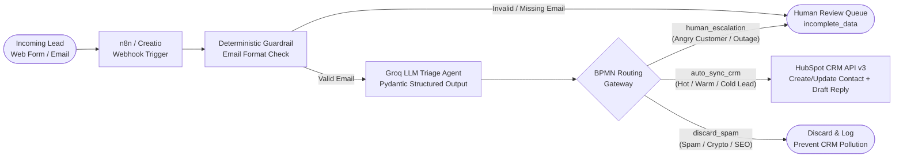
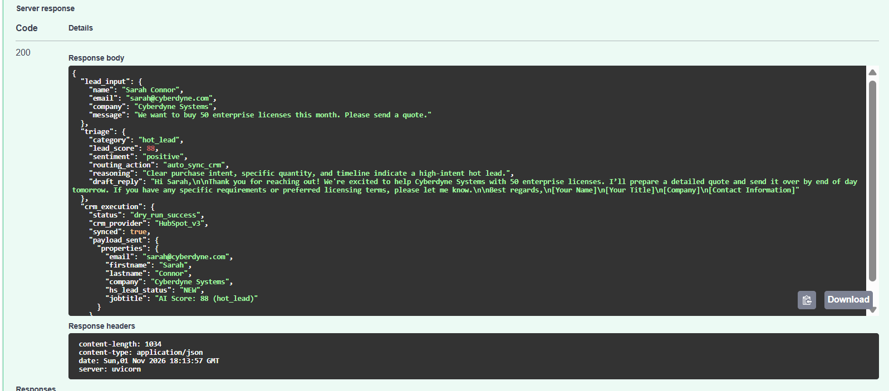

# AI CRM Lead-Triage & Business Process Automation (`ai-crm-lead-automation`)

An end-to-end **AI Lead-Handling & CRM Process Automation** microservice built with **FastAPI**, **LangChain (`langchain-groq`)**, **Pydantic v2**, **HubSpot CRM REST API v3**, and an importable **n8n Low-Code Workflow**.

Designed to bridge **Low-Code BPMN Process Automation** (Creatio / n8n) with **Production LLM Guardrails**: incoming leads from web forms or emails are validated, classified, scored (0–100), and routed deterministically—auto-syncing qualified leads to CRM while escalating angry customers or incomplete records to a human review queue.

---

## BPMN Business Process Diagram



---

## Live API Execution (FastAPI Swagger UI -> Groq LLM -> HubSpot v3 Payload)



---

## Key Engineering Highlights

* **Strict Structured Outputs (`schemas.py`):** Uses Pydantic v2 `Literal` enums and constrained integer scores (`0–100`) with `.with_structured_output()` so downstream low-code nodes in **Creatio** or **n8n** receive a guaranteed JSON schema.
* **Defense-in-Depth Guardrails (`agent.py`):**
  * **Pre-LLM Validation:** Catches missing or malformed email addresses deterministically before spending LLM tokens.
  * **Post-LLM Business Rules:** Enforces hard routing overrides so `angry_customer` messages are **always** routed to `human_escalation` and never auto-replied to by a bot.
* **CRM API Integration with Dry-Run Mode (`crm_client.py`):** Integrates with the **HubSpot CRM Contacts v3 REST API** (`POST /crm/v3/objects/contacts`) while supporting `CRM_DRY_RUN=true` for offline CI testing.
* **Low-Code Interoperability (`workflows/n8n_lead_triage_workflow.json`):** Includes a ready-to-import **n8n** workflow connecting a Webhook trigger, HTTP Request node, and BPMN Switch Router.

---

## Evaluation Benchmark Results (5/5 — 100%)

Run `python evals/evaluate_triage.py` to execute the live multi-scenario benchmark against Groq:

| Scenario | Expected Category | Score | Routing Action | CRM Synced | Status |
| :--- | :--- | :---: | :--- | :---: | :---: |
| **1. Enterprise Hot Lead** (200 seats migration) | `hot_lead` | 92 | `auto_sync_crm` | `True` | PASS |
| **2. General Pricing Inquiry** (15 seats Q3) | `warm_lead` | 55 | `auto_sync_crm` | `True` | PASS |
| **3. Angry Customer Escalation** (System outage) | `angry_customer` | 90 | `human_escalation` | `False` | PASS |
| **4. Unsolicited Spam Pitch** (Crypto SEO spam) | `spam` | 0 | `discard_spam` | `False` | PASS |
| **5. Missing Email Edge Case** (Blank email) | `incomplete_data` | 20 | `human_escalation` | `False` | PASS |

---

## Quick Start (Windows PowerShell)

```powershell
# 1. Create and activate virtual environment
python -m venv .venv
.\.venv\Scripts\Activate.ps1

# 2. Install dependencies
pip install -r requirements.txt

# 3. Configure environment variables
cp .env.example .env
# Add your GROQ_API_KEY in .env

# 4. Run deterministic unit tests (CI suite)
python -m pytest -v

# 5. Run live LLM benchmark evaluation
python evals\evaluate_triage.py

# 6. Start the FastAPI webhook server (includes interactive Swagger UI at /docs)
uvicorn app:app --reload
```
